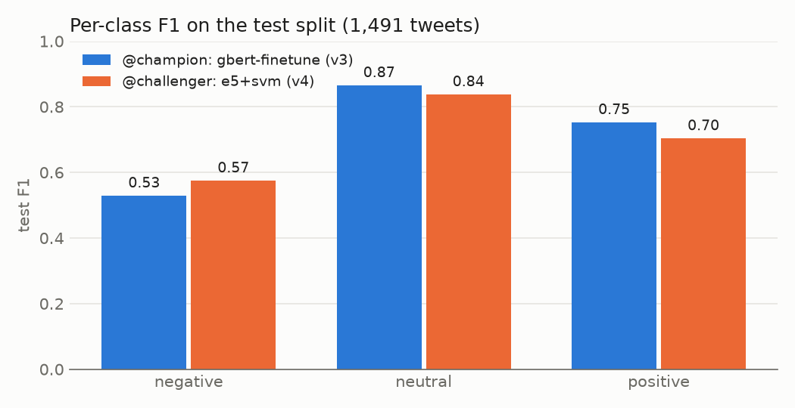
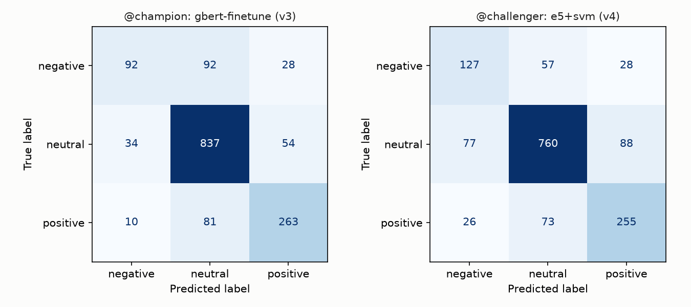
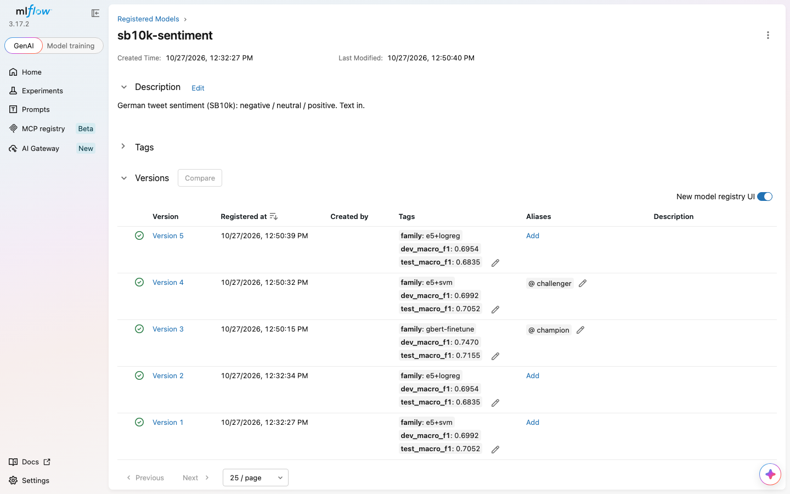
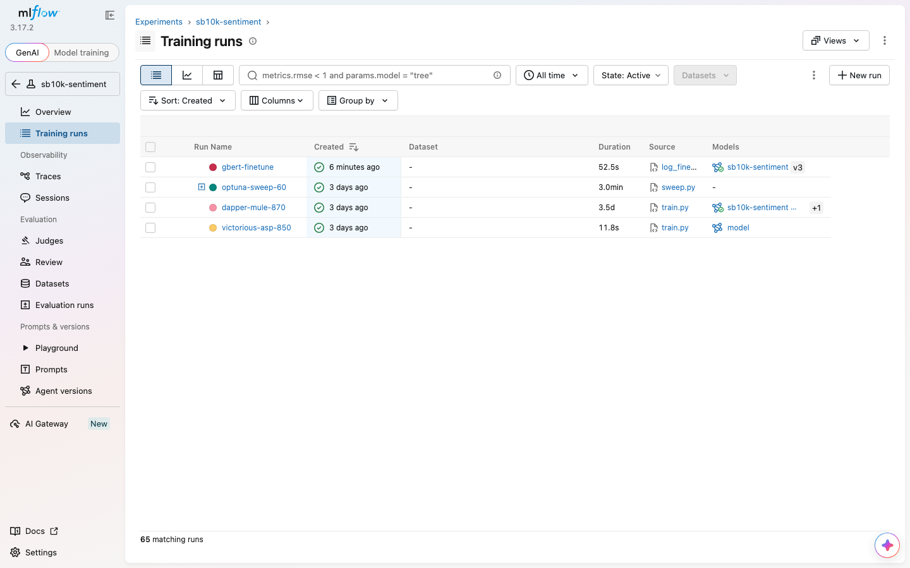
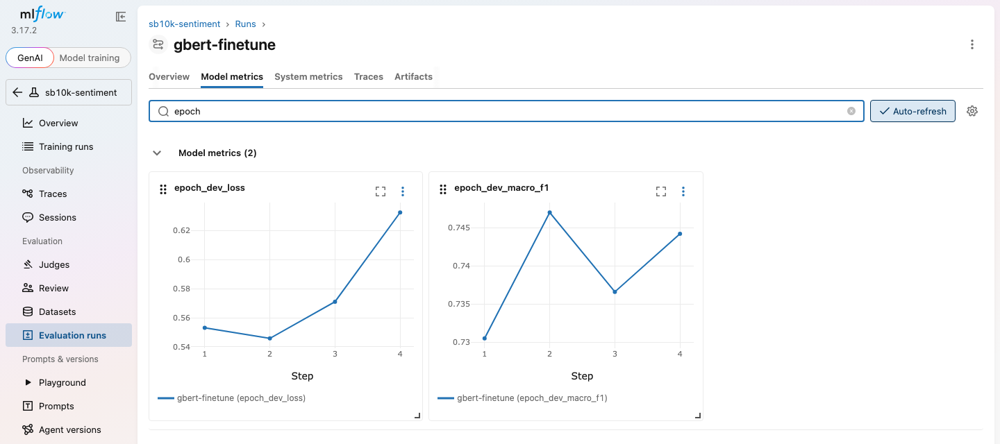
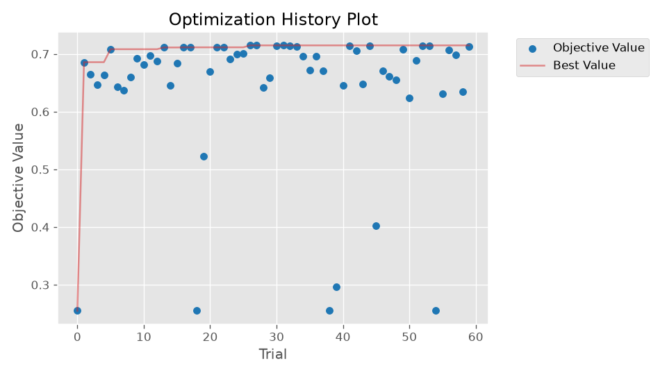
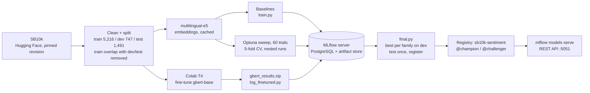

# Sentiment MLflow Pipeline

Sentiment classification of German tweets (SB10k: negative / neutral / positive) as a **tracked, reproducible MLflow pipeline**. Every training run, all 60 Optuna sweep trials and a Colab GPU fine-tune are logged to an **MLflow server backed by PostgreSQL** (Docker Compose). The best model of each family is picked on dev, scored once on test, registered in the **model registry** with `@champion` / `@challenger` aliases, and served as a REST API with `mlflow models serve`.

[](https://github.com/abhisheklakhani-it/sentiment-mlflow-pipeline/actions/workflows/ci.yml)


```console
$ make serve      # serves models:/sb10k-sentiment@champion on :5051
$ curl -s localhost:5051/invocations -H 'Content-Type: application/json' -d '{"dataframe_records": [
    {"text": "Das Essen war richtig lecker, gerne wieder!"},
    {"text": "Der Zug hat schon wieder 40 Minuten Verspätung. Unfassbar."},
    {"text": "Die Sitzung beginnt um 14 Uhr im Raum 3."},
    {"text": "Na toll, schon wieder Regen am Wochenende."}]}'
{"predictions": [{"label": "positive", "confidence": 0.9657}, {"label": "negative", "confidence": 0.8127},
                 {"label": "neutral", "confidence": 0.9722}, {"label": "negative", "confidence": 0.8287}]}
```

## Results

SB10k test split, 1,491 tweets, scored once after the champion was chosen on dev. Raw numbers: [`results/final.json`](results/final.json) and [`results/comparison.json`](results/comparison.json).

| Registry version | Model | Chosen by | Dev macro-F1 | Test macro-F1 | Test accuracy |
|---|---|---|---|---|---|
| **v3 `@champion`** | **Fine-tuned `deepset/gbert-base`** (best of 4 epochs) | dev | **0.747** | **0.716** | **0.800** |
| v4 `@challenger` | `multilingual-e5-base` embeddings + linear SVM (C = 0.53, balanced) | 60-trial Optuna sweep, 5-fold CV | 0.699 | 0.705 | 0.766 |
| v5 | `multilingual-e5-base` embeddings + logistic regression (C = 1, balanced) | hand-picked baseline | 0.695 | 0.684 | 0.725 |

Macro-F1 averages the three classes equally, so the small negative class (212 of 1,491 test tweets) counts as much as neutral (925). Versions 1 and 2 in the registry are the e5 models from the first `final` run, before the gbert run was logged.

**Is the difference real?** On the same 1,491 tweets, gbert is right on 155 tweets where the SVM is wrong, and the SVM on 105 where gbert is wrong. An exact McNemar test gives p = 0.002, so gbert's lead is not luck. 194 tweets are wrong for both.





**Speed** (M2 Mac, 8 GB, batch of 1,491 tweets): e5 + SVM 7.3 ms per tweet, gbert 13.8 ms per tweet. The gbert fine-tune took 2.2 minutes on a Colab T4.

## The MLflow side

**Model registry.** Each finalist becomes a version of `sb10k-sentiment`, tagged with its family and dev/test scores. Clients load `models:/sb10k-sentiment@champion`, so promoting a new model is one alias change and needs no code change. (MLflow 3 replaced the old *Staging / Production* stages with aliases.)



**Runs.** 65 runs in one experiment: two hand-picked baselines, the sweep (a parent run with 60 nested trial runs), the retrained sweep winner and the Colab fine-tune. Every run logs its parameters, metrics, a classification report, a confusion matrix and its model.



**The Colab run in MLflow.** gbert trains on Colab, where the MLflow server can't be reached. The notebook saves a JSON of params, per-epoch metrics and the model; `make log-gbert` replays it into MLflow as a normal run. Dev loss is lowest after epoch 2 and rises afterwards (overfitting), so the epoch-2 checkpoint is kept.



**The sweep.** Optuna (TPE sampler, seed 42) searched encoder, classifier, C and class weighting. Each trial is scored by 5-fold cross-validation on train, not on dev, so 60 trials cannot overfit the dev set. The best CV macro-F1 is 0.715.



## What I learned

- **Only one hyperparameter really mattered.** Optuna rates C at 0.98 importance; the encoder (e5-small vs e5-base), the classifier (SVM vs logistic regression) and class weighting are all below 0.01 *within the sweep*. Four trials score exactly 0.255, the macro-F1 of predicting "neutral" for every tweet: with C below 0.02, the regularisation is so strong that the model learns nothing else.
- **Fine-tuning won overall but lost on negative tweets.** gbert labels 92 of the 212 negative test tweets as *neutral*; the SVM does that only 57 times, and its negative F1 is higher (0.57 vs 0.53). The sweep chose `class_weight="balanced"` for the SVM, while gbert was trained with a plain, unweighted loss on data that is 62% neutral. gbert wins anyway because it is much better on neutral and positive tweets.
- **Dev overstates the champion.** gbert scores 0.747 on dev but 0.716 on test. The epoch was picked on dev, which flatters the dev score. The SVM, chosen by cross-validation on train, scores about the same on dev and test (0.699 / 0.705). This is why test is touched only once, at the end.
- **gbert's confidence is useful.** On the 57% of test tweets where it is at least 0.9 confident, it is right 92.6% of the time; between 0.7 and 0.9, 71.8%; below 0.7, 51.9%. A real system could auto-label the confident ones and send the rest to a person.
- **Two tracking stores drift apart.** At first, the registry lived in a local `mlflow.db` file while the sweep runs were on the Docker server, so `make serve` found no model. Running `make final` against the server reproduced the identical scores (0.7052 test macro-F1) and put everything in one place. Lesson: pick one tracking URI and set it in the Makefile.

## How it works



| File | What it does |
|---|---|
| `src/sentiflow/data.py` | Loads SB10k at a pinned revision, masks URLs and user names, drops duplicates and train tweets that also appear in dev/test |
| `src/sentiflow/embed.py` | `multilingual-e5-small` / `-base` embeddings (pinned revisions, `query: ` prefix), cached on disk per split |
| `src/sentiflow/models.py` | Classifier families and the text-in pyfunc wrappers (`EmbeddingSentimentModel`, `GbertSentimentModel`) that MLflow serves |
| `src/sentiflow/evaluate.py` | Macro-F1, accuracy, per-class F1, classification report and confusion matrix, shared by all models |
| `src/sentiflow/train.py` | Trains one embedding model and logs params, metrics, reports and the model to MLflow |
| `src/sentiflow/sweep.py` | Optuna sweep with a nested MLflow run per trial; retrains and logs the best configuration |
| `src/sentiflow/finetune.py` | gbert fine-tuning with the Hugging Face `Trainer`, keeps the best epoch on dev |
| `src/sentiflow/log_finetuned.py` | Replays the Colab run (params, per-epoch metrics, model) into MLflow |
| `src/sentiflow/final.py` | Picks the best run per family on dev, scores finalists on test once, registers them and sets the aliases |
| `scripts/make_colab_notebook.py` | Generates the Colab notebook from `src/`, so Colab trains with the same split and metrics |
| `scripts/compare.py` | Loads `@champion` and `@challenger` from the registry; McNemar test, charts and confidence buckets |
| `docker-compose.yml`, `docker/` | MLflow server + PostgreSQL, artifacts proxied by the server, bound to localhost only |

## Running it

Needs [uv](https://docs.astral.sh/uv/) and Docker.

```bash
make install       # uv sync
make mlflow-up     # MLflow + PostgreSQL, UI on http://localhost:5050
make baselines     # e5-small and e5-base + logistic regression (embeddings take a few minutes the first time)
make sweep         # 60 Optuna trials, about 3 min once embeddings are cached
```

**gbert (needs a GPU)**

```bash
make notebook      # writes notebooks/finetune_gbert_colab.ipynb
```

Upload the notebook to Google Colab, choose a T4 GPU and run all cells (about 15 min with setup). Put the downloaded `gbert_results.zip` in the project folder, then:

```bash
make log-gbert     # logs the Colab run into MLflow
make final         # champion on dev, test once, register + aliases
make serve         # REST API for @champion on http://localhost:5051
uv run python scripts/compare.py
```

`make all` runs the whole chain. Without the gbert step, `final` still works and the e5 + SVM model becomes the champion.

**Tests** (12, no network, MLflow server or trained model needed)

```bash
make test
make lint
```

## Limitations

- **One run each.** Every model was trained once with seed 42. With 1,491 test tweets, the 95% confidence interval of a macro-F1 near 0.7 is roughly ±2.5 points, so the McNemar test above matters more than the third decimal.
- **GPU training is not bit-for-bit reproducible.** Seeds, data and model revisions are pinned, but a rerun of the Colab notebook can differ slightly in the last decimals.
- **SB10k is small and dated.** About 7,450 labeled tweets after cleaning, from one period of German Twitter; slang and topics have changed since.
- **gbert was not class-weighted** and only one learning rate and epoch budget were tried; a weighted loss would probably help the negative class.
- **Confidence is not calibrated.** gbert's softmax score was checked against accuracy, but no calibration was applied. The SVM returns no confidence.
- **Local setup only.** The MLflow server has no authentication and listens on localhost; trained models and the database are not published (`mlruns/`, `mlflow.db`, `outputs/` and `*.zip` are gitignored).

## Next steps

- [ ] Fine-tune gbert with a class-weighted loss and compare negative-class F1
- [ ] Repeat the fine-tune with 3 seeds and report the spread
- [ ] GitHub Actions: lint + tests on every push
- [ ] Log the tweets where both models are wrong as an MLflow artifact for error analysis
